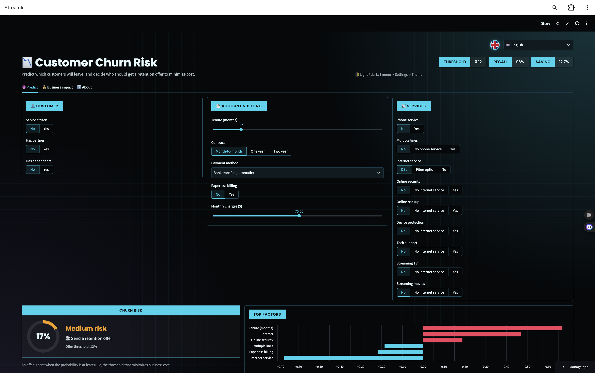
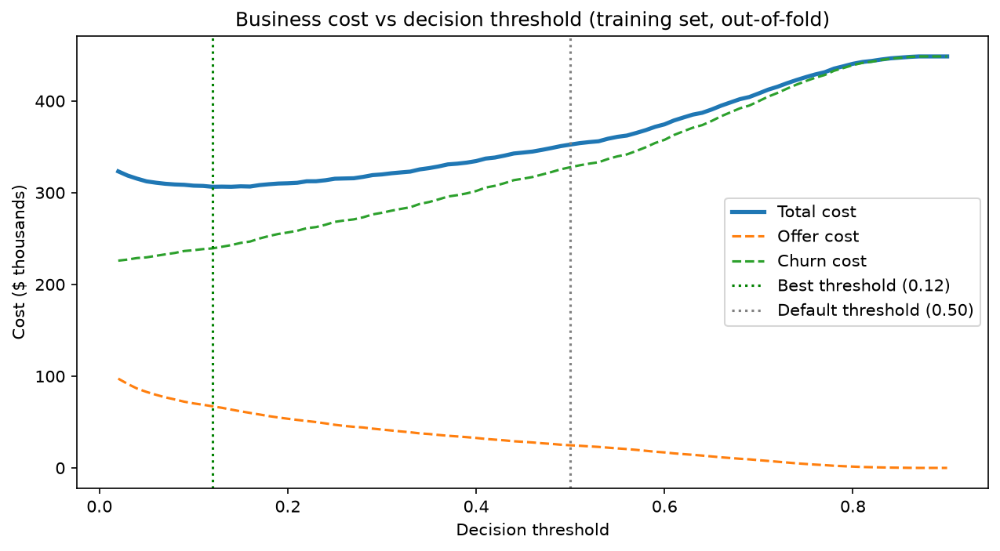
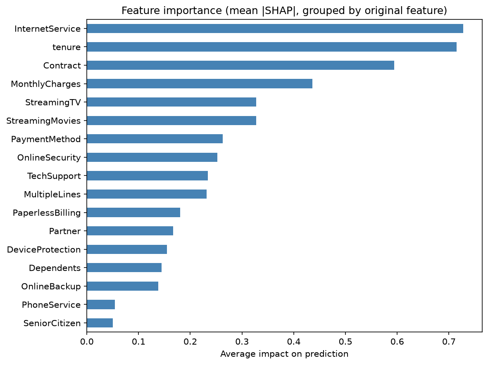

# 📉 Customer Churn Prediction with Cost-Based Decision Threshold

Predicting which telecom customers will leave, and deciding **who should get a retention offer** by minimizing business cost instead of using the default 0.5 threshold.

🔗 **Live demo:** https://glitter-customer-churn-proj.streamlit.app



## 🎯 Key result

At the default 0.5 threshold, the model **cost more than simply giving every customer a discount**.
Choosing the threshold from business costs (**0.12**) made it the cheapest strategy on unseen test data:

| Strategy (1,409 test customers) | Churners caught | False alarms | Total cost |
|---|---|---|---|
| Do nothing | 0 / 374 | 0 | $112,200 |
| Model, threshold 0.50 | 207 / 374 (55%) | 116 | $87,610 |
| Offer to everyone | 374 / 374 | 1,035 | $84,280 |
| **Model, threshold 0.12** | **349 / 374 (93%)** | 483 | **$76,490** |

➡️ **12.7% cheaper than the default threshold**, about **$79,000 saved per 10,000 customers**.



## 💼 Business problem

A telecom company loses ~26.5% of its customers. The retention team can send discount offers, but offers cost money.

**Assumptions:**
- Retention offer: **$20** per targeted customer
- Lost customer: **$300** in revenue
- An offer keeps **50%** of the churners who receive it


Missing a churner (false negative) is far more expensive than a wasted offer (false positive), so the decision threshold should be much lower than 0.5. Break-even: 20 / (0.5 × 300) ≈ **0.13**.

## 🔬 Approach

| Step | What I did | Notebook |
|---|---|---|
| 1. EDA | Churn rates by segment, data-quality checks (found hidden blank values in `TotalCharges`) | `01_eda.ipynb` |
| 2. Leakage audit | Single-feature AUC test (max 0.74 → no obvious leakage); dropped `TotalCharges` (corr 1.000 with tenure × monthly charges) and `gender` (no signal + fairness risk) | `02_leakage_and_features.ipynb` |
| 3. Modeling | Stratified train/test split, scikit-learn Pipeline (scaling + one-hot encoding), 5-fold stratified cross-validation | `03_modeling.ipynb` |
| 4. Class imbalance | Compared class weights, SMOTE and XGBoost; all shifted recall/precision but barely changed ranking (PR-AUC) | `03_modeling.ipynb` |
| 5. Threshold & cost | Out-of-fold predictions → cost curve → best threshold; one-time evaluation on the locked test set | `04_threshold_and_cost.ipynb` |
| 6. Explainability | SHAP values: global drivers and individual explanations | `05_explainability.ipynb` |
| 7. App | Streamlit dashboard with predictions, explanations and an interactive cost simulator (English / Thai / Burmese) | `app/` |

### Model comparison (5-fold CV on training set)

| Model | Precision | Recall | ROC-AUC | PR-AUC |
|---|---|---|---|---|
| Dummy (always "No") | 0.000 | 0.000 | 0.500 | 0.265 |
| **Logistic Regression** ✅ | 0.653 | 0.538 | 0.845 | 0.660 |
| Logistic Regression (balanced) | 0.519 | 0.793 | 0.845 | 0.658 |
| Logistic Regression + SMOTE | 0.533 | 0.774 | 0.844 | 0.658 |
| XGBoost | 0.658 | 0.518 | 0.844 | 0.666 |
| XGBoost (weighted) | 0.530 | 0.782 | 0.844 | 0.665 |

**Chosen model: Logistic Regression.** XGBoost was only ~0.006 PR-AUC higher (within fold-to-fold noise of ±0.018), while Logistic Regression is simpler, easier to explain, and its probabilities aren't distorted by class weights. Recall was improved through the cost-based threshold instead.

**Test set:** ROC-AUC 0.839, PR-AUC 0.630, close to cross-validation, so the model generalizes.

## 🔍 What drives churn




- **Contract:** month-to-month customers churn at 43% vs 3% on two-year contracts
- **Tenure:** 52.9% churn in the first 6 months vs 9.5% after 4+ years
- **Internet service:** fiber optic customers churn at 42% vs 19% for DSL
- **Support services:** customers without tech support or online security churn at ~42%

## 💡 Business recommendations

1. **Convert month-to-month customers to longer contracts** with a discount for switching to a 1- or 2-year plan.
2. **Create a "first 6 months" onboarding program**: most churn happens early.
3. **Investigate the fiber optic experience** (price or service quality) and consider bundling free tech support or online security.
4. **Target offers using the model's risk scores with a 0.12 threshold**, and review it whenever offer costs or success rates change.

## 🖥️ The app

- 🔮 **Predict:** enter a customer profile → churn probability, risk level, decision, and the top factors behind it
- 💰 **Business impact:** change offer cost, churn cost, success rate and threshold → see total cost, churners caught and the cheapest threshold update live
- 🌐 English / ไทย / မြန်မာ · 🌓 light and dark mode · 📱 mobile-friendly

## 📁 Project structure

```
├── app/
│   ├── streamlit_app.py      # Streamlit dashboard
│   └── translations.py       # English / Thai / Burmese text
├── data/raw/                 # Original dataset (unchanged)
├── models/churn_model.joblib # Trained pipeline + chosen threshold
├── notebooks/                # 01–05: EDA → leakage → modeling → threshold → SHAP
├── reports/figures/          # Charts used in this README
├── src/
│   ├── data.py               # Loading and cleaning

│   ├── features.py           # Feature decisions from the leakage audit
│   ├── model.py              # Preprocessing + Logistic Regression pipeline
│   └── costs.py              # Business cost assumptions and calculation
├── requirements.txt          # Packages for the app
└── requirements-dev.txt      # Full environment for the notebooks
```

## ▶️ Run locally

```bash
git clone https://github.com/K-S-G-97/customer-churn-ml-project.git
cd customer-churn-ml-project
python -m venv venv
source venv/bin/activate
pip install -r requirements-dev.txt
streamlit run app/streamlit_app.py
```

## ⚠️ Limitations & next steps

- Results depend on the cost assumptions ($20 offer, $300 churn, 50% save rate); the app lets you test other values.
- The dataset is a **fictional IBM sample** and a single snapshot, so the timing of each feature can't be verified.
- New customers (tenure = 0) were kept; in production they could be excluded until their behavior is observable.
- "No internet service" is repeated across several columns; merging them could simplify the model.
- Next: validate on a second, more recent churn dataset; build a Next.js frontend with a FastAPI backend.

## 📊 Data

[IBM Telco Customer Churn](https://www.kaggle.com/datasets/blastchar/telco-customer-churn): 7,043 customers, 21 columns.

---
👤 **Kaung Glitter** · [GitHub](https://github.com/K-S-G-97) · [LinkedIn](https://www.linkedin.com/in/kaung-sat-glitter-7ks976977g/)